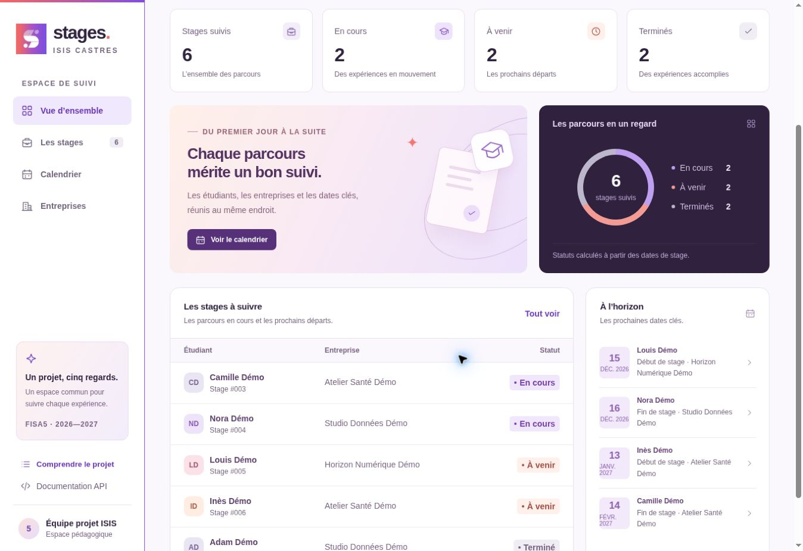

# Gestion des stages


**Mini-projet Cloud Computing, Microservices et API : ISIS Castres, FISA5, 2026-2027**  
**Enseignante :** Emna Trigui  
**Groupe :** Rémi DELARUE, Romane CANO, Alexis DECHENAIS, Yasmine JAOU et Lina KHADLY.

Nous avons développé une plateforme permettant de créer, consulter, modifier et supprimer les stages d’une école. Le projet associe une API REST FastAPI, un stockage SQLite et une interface web. L’ensemble fonctionne dans un conteneur Docker déployé sur le plan gratuit de Render.

Ce dépôt rassemble le code source, les commandes de lancement, la documentation des endpoints et les preuves des essais. Les données utilisées sont exclusivement fictives.

## Accéder à la solution

- **[Application web](https://isis-gestion-stages-api.onrender.com/)** : gestion des stages, calendrier et visite guidée.
- **[Swagger](https://isis-gestion-stages-api.onrender.com/docs)** : documentation et essais interactifs de l’API.
- **[Contrat OpenAPI](https://isis-gestion-stages-api.onrender.com/openapi.json)** : description des routes et des schémas au format JSON.
- **[Guide de compréhension](https://isis-gestion-stages-api.onrender.com/guide)** : explication du fonctionnement de la plateforme.

Le service gratuit peut être mis en veille. Le premier accès peut donc nécessiter un temps de réveil. Les données sont partagées entre les visiteurs et peuvent disparaître lors d’une mise en veille, d’un redémarrage ou d’un redéploiement.

## Réponse au travail demandé

Nous avons suivi les quatre étapes du sujet : développer l’API avec SQLite, tester ses endpoints avec Swagger, construire et exécuter une image Docker, puis déployer le service sur Render Free. L’interface web, l’export CSV et le tutoriel complètent ce périmètre.

Les cinq livrables demandés sont accessibles depuis les emplacements suivants.

| Livrable | Emplacement |
|---|---|
| Code source sur GitHub | Ce dépôt, notamment [app/](app/) et [tests/](tests/). |
| Dockerfile | [Dockerfile](Dockerfile), à la racine du projet. |
| URL publique de l’API | [Collection des stages](https://isis-gestion-stages-api.onrender.com/stages) et [Swagger](https://isis-gestion-stages-api.onrender.com/docs). |
| Courte documentation des endpoints | [Table des routes et exemple JSON](#endpoints), ci-dessous. |
| Captures de fonctionnement et de déploiement | [Index des captures et journaux](docs/preuves.md), avec des essais sur l’URL publique Render. |

Le rapport final PDF accompagne la remise et présente la démarche collective ainsi que les difficultés rencontrées. Le dépôt est public et permet de consulter le code ainsi que les journaux GitHub Actions.

## Fonctionnement de la plateforme

L’interface utilise la même API que Swagger et propose quatre vues : une vue d’ensemble, la liste des stages, un calendrier et un regroupement par entreprise. La liste permet de rechercher, filtrer, trier, consulter une fiche et effectuer les opérations de gestion.

Les statuts affichés sont calculés à partir des dates ; ils ne correspondent pas à une validation pédagogique et n’ajoutent aucun champ au modèle SQLite. L’export CSV reprend tous les résultats filtrés, y compris les autres pages, et neutralise les valeurs susceptibles d’être interprétées comme des formules de tableur.

Une visite guidée de six étapes accompagne la première ouverture. Le bouton **?** permet de la relancer ; **Passer**, la croix ou **Échap** la ferment. Elle ne modifie aucun stage. Le chargement des six exemples fictifs demande une confirmation explicite.



*Capture du site public réalisée le 24 novembre 2026. Les données de démonstration peuvent être réinitialisées par l’hébergement.*

## Endpoints

### Modèle d’un stage

Un stage possède les six champs demandés dans l’énoncé. Le serveur génère l’identifiant ; les cinq autres champs sont obligatoires à la création et à la modification.

| Champ | Type et règle |
|---|---|
| `id` | Entier généré par SQLite, renvoyé par l’API. |
| `nom_etudiant` | Texte non vide, limité à 120 caractères. |
| `entreprise_accueil` | Texte non vide, limité à 160 caractères. |
| `intitule_stage` | Texte non vide, limité à 240 caractères. |
| `date_debut` | Date calendaire au format `AAAA-MM-JJ`. |
| `date_fin` | Date au même format, égale ou postérieure au début. |

Les espaces aux extrémités des textes sont retirés avant validation. Les champs supplémentaires, les dates invalides et les identifiants de chemin non valides sont refusés. Un identifiant de chemin doit être un entier positif écrit en chiffres, compatible avec SQLite.

### Routes disponibles

| Méthode | Chemin | Opération | Réponse attendue |
|---|---|---|---|
| `GET` | `/stages` | Lister les stages par identifiant croissant. | `200`, tableau JSON ; `[]` si la base est vide. |
| `GET` | `/stages/{id}` | Consulter un stage. | `200`, stage demandé ; `404` si absent. |
| `POST` | `/stages` | Créer un stage. | `201`, stage créé et en-tête `Location`. |
| `PUT` | `/stages/{id}` | Remplacer les cinq champs éditables. | `200`, stage modifié ; `404` si absent. |
| `DELETE` | `/stages/{id}` | Supprimer un stage. | `204`, sans corps ; `404` si absent. |
| `GET` | `/health` | Vérifier que l’application répond après son initialisation. | `200`, `{"status":"ok"}`. |

Une saisie ou un identifiant invalide renvoie `422` avec le détail des erreurs. Un stage absent renvoie `404` avec `{"detail":"Stage introuvable."}`. `PUT` exige les cinq champs ; une modification partielle est refusée et ne crée pas de stage si l’identifiant est absent.

### Exemple de création

Envoyer le corps suivant à `POST /stages`, au format `application/json`.

```json
{
  "nom_etudiant": "Étudiant Démo",
  "entreprise_accueil": "Atelier Nuage Démo",
  "intitule_stage": "Concevoir un tableau de bord de suivi",
  "date_debut": "2027-02-01",
  "date_fin": "2027-07-30"
}
```

Le serveur répond `201` avec les cinq valeurs et l’`id` généré. L’en-tête `Location` indique le chemin de la ressource créée, par exemple `/stages/1`. Cette valeur est illustrative : il faut toujours reprendre l’identifiant réellement retourné.

### Rejouer les essais avec Swagger

1. Accéder à [Swagger](https://isis-gestion-stages-api.onrender.com/docs), ouvrir `POST /stages`, puis sélectionner **Try it out**. Envoyer l’exemple ci-dessus et vérifier la réponse `201`.
2. Copier l’`id` reçu, exécuter `GET /stages` pour retrouver le stage dans la liste, puis `GET /stages/{id}` pour consulter son détail.
3. Exécuter `PUT /stages/{id}` avec les cinq champs en changeant l’intitulé. Vérifier `200`, puis relire le stage pour constater la modification.
4. Essayer une date de fin antérieure au début pour observer le rejet `422`.
5. Supprimer le stage de test avec `DELETE /stages/{id}`. Vérifier `204` sans corps, puis relire le même identifiant pour obtenir `404`.

Ce parcours couvre les cinq situations demandées dans le sujet. Il utilise un stage fictif créé pour l’essai et le supprime à la fin. Les [captures Swagger](docs/preuves.md#service-render-et-captures-réalisées) documentent les réponses obtenues sur le service public.

## Démarrage local

Les commandes suivantes s’exécutent depuis la racine du dépôt, dans le dossier qui contient `Dockerfile`, `requirements.txt` et `app/`.

```bash
git clone https://github.com/Remi26d/ISIS_-gestion-stages-api.git
cd ISIS_-gestion-stages-api
```

Le dépôt public peut être cloné sans autorisation particulière. Deux modes de lancement sont possibles.

### Avec Docker

Démarrer Docker Desktop ou Docker Engine, puis exécuter chaque commande sur une seule ligne. Le nom de conteneur et le port local doivent être disponibles.

```bash
docker build -t stages:local .
docker run -d --name gestion-stages -p 127.0.0.1:8000:8000 stages:local
```

Ces commandes fonctionnent avec PowerShell et Bash. Accéder ensuite au [site local](http://127.0.0.1:8000/) et à [Swagger local](http://127.0.0.1:8000/docs). L’image contient aussi le logo, le guide et le tutoriel ; aucun serveur frontend séparé n’est nécessaire.

La base se trouve dans le conteneur. Ce lancement ne monte pas de volume : supprimer puis recréer le conteneur ne conserve pas ses stages.

### Avec Python sous Windows PowerShell

Utiliser Python 3.12 et SQLite 3.35 ou supérieur.

```powershell
py -3.12 -m venv .venv
.\.venv\Scripts\python.exe -m pip install -r requirements.txt
.\.venv\Scripts\python.exe -m uvicorn app.main:app --host 127.0.0.1 --port 8000
```

### Avec Python sous Linux ou macOS

```bash
python3.12 -m venv .venv
./.venv/bin/python -m pip install -r requirements.txt
./.venv/bin/python -m uvicorn app.main:app --host 127.0.0.1 --port 8000
```

Les adresses locales sont les mêmes que pour Docker. Au démarrage, l’application crée `data/stages.sqlite3` si nécessaire. La variable `DATABASE_PATH` permet de choisir un autre fichier ; réutiliser le même fichier conserve les stages entre deux lancements Python. La version SQLite se vérifie avec `python -c "import sqlite3; print(sqlite3.sqlite_version)"`, en utilisant le Python de l’environnement virtuel.

## Architecture

Nous avons séparé les routes HTTP, la validation et les accès à SQLite pour pouvoir vérifier chaque responsabilité. Le projet reste un service unique : les modules ne sont pas des microservices déployés séparément.

| Emplacement | Responsabilité |
|---|---|
| [app/main.py](app/main.py) | Routes, réponses HTTP, initialisation et livraison des fichiers web. |
| [app/schemas.py](app/schemas.py) | Modèles Pydantic et contrôles de saisie. |
| [app/database.py](app/database.py) | Table SQLite, requêtes paramétrées et transactions. |
| [app/web/](app/web/) | Interface HTML, CSS et JavaScript, guide et tutoriel. |
| [tests/](tests/) | Tests de validation, de persistance, de l’API et de la logique web. |
| [.github/workflows/ci.yml](.github/workflows/ci.yml) | Vérifications automatiques et essais de l’image Docker. |
| [scripts/](scripts/) | Vérification HTTP et accompagnement du lancement sous Windows. |
| [docs/](docs/) et [preuves/](preuves/) | Documentation, captures et journaux datés. |

Les valeurs reçues sont liées à des paramètres SQL. Chaque opération utilise une connexion et une transaction, validée en cas de succès ou annulée en cas d’erreur.

## Tests et couverture

Les commandes ci-dessous supposent le lancement Python décrit plus haut. Utiliser l’exécutable de l’environnement virtuel pour installer et lancer les outils.

**Windows PowerShell**

```powershell
.\.venv\Scripts\python.exe -m pip install -r requirements-dev.txt
.\.venv\Scripts\python.exe -m ruff check app tests scripts
.\.venv\Scripts\python.exe -m pytest --cov=app --cov-report=term-missing --cov-fail-under=80
```

**Linux ou macOS**

```bash
./.venv/bin/python -m pip install -r requirements-dev.txt
./.venv/bin/python -m ruff check app tests scripts
./.venv/bin/python -m pytest --cov=app --cov-report=term-missing --cov-fail-under=80
```

La logique JavaScript se vérifie séparément avec Node 24.

```bash
node --test tests/test_web_logic.mjs
```

Le [workflow GitHub Actions](.github/workflows/ci.yml) contrôle également la syntaxe JavaScript et PowerShell, construit l’image et teste les routes HTTP dans un conteneur avec `PORT=10000`. Les tests Python utilisent des bases temporaires, distinctes de la base de démonstration.

Pour vérifier un service déjà démarré, le script suivant accepte son adresse de base. Sous Windows, remplacer `./.venv/bin/python` par `.\.venv\Scripts\python.exe`.

```bash
./.venv/bin/python scripts/verifier_service.py http://127.0.0.1:8000
```

Ce script vérifie l’API et les ressources web en créant puis supprimant son propre stage fictif.

### Résultats conservés

Les [essais du 24 novembre 2026](preuves/2026-11-24/) ont validé 23 tests Python, 7 tests JavaScript, la construction Docker et le parcours HTTP public. La couverture mesurée porte sur 141 instructions et 16 sorties de branche du code Python, soit 100 %. Elle ne mesure pas l’ensemble des interactions du navigateur et ne constitue pas une garantie d’absence de bugs.

Le [journal Actions](preuves/2026-11-24/02-actions.txt), le [contrôle public](preuves/2026-11-24/01-controle-public.txt) et le [compte rendu visuel](preuves/2026-11-24/05-validation-visuelle.md) précisent les résultats et leur contexte. La suite Python signale un avertissement de dépréciation HTTPX/Starlette ; les tests restent réussis.

## Docker et Render

Le service public utilise l’environnement **Docker** et le plan **Free**. Uvicorn écoute sur `0.0.0.0` et utilise la variable `PORT` fournie par Render, avec `8000` comme valeur locale par défaut. Le conteneur s’exécute avec un utilisateur non privilégié.

Pour reproduire le déploiement, autoriser le dépôt GitHub dans Render, créer un **Web Service**, sélectionner la branche `main`, l’environnement **Docker** et le plan **Free**, puis lancer le déploiement. Après la mise en ligne, vérifier Swagger et rejouer le scénario CRUD sur l’URL obtenue. Le [guide de déploiement](docs/deploiement.md) détaille la procédure.

Dans la configuration du service existant, Render déploie au commit sans attendre la CI et utilise une sonde de démarrage TCP. La route `/health` a été contrôlée séparément par HTTP. Le fichier [render.yaml](render.yaml) propose une configuration alternative par Blueprint ; il ne représente pas les réglages appliqués à ce service.

## Limites et documents complémentaires

Les endpoints sont publics et ne demandent pas d’authentification. La démonstration doit donc rester limitée aux données fictives. Le stockage SQLite de Render Free est éphémère, et le chargement des exemples ne remplace pas une sauvegarde. Un usage réel demanderait notamment des droits d’accès, un stockage durable et des sauvegardes.

- [Captures et preuves datées](docs/preuves.md)
- [Rapport de vérification technique](docs/verification.md)
- [Guide Windows](docs/guide-windows.md)
- [Guide de l’interface](docs/interface.md)
- [Guide de compréhension au format PDF](app/web/guide-soutenance.pdf)
- [Correspondance avec l’énoncé](docs/audit-enonce.md)
