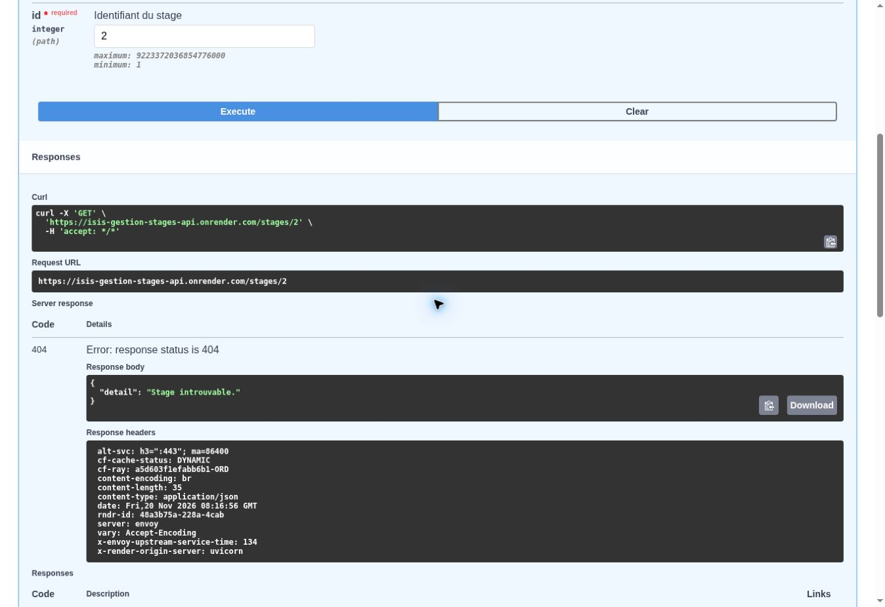

# Captures et preuves

## Preuves locales jointes

| Fichier | Contenu vérifiable |
|---|---|
| [01-tests-couverture.txt](../preuves/local/01-tests-couverture.txt) | Sortie réelle de la suite, des résultats et de la mesure des lignes. |
| [02-parcours-http.txt](../preuves/local/02-parcours-http.txt) | Requêtes du scénario complet sur Uvicorn local et statuts reçus. |
| [03-journaux-uvicorn.txt](../preuves/local/03-journaux-uvicorn.txt) | Journaux de démarrage, d’accès et d’arrêt du serveur HTTP local. |
| [04-pytest-cov.txt](../preuves/local/04-pytest-cov.txt) | 21 tests réussis et couverture des instructions et branches mesurée avec pytest-cov le 20 novembre 2026. |
| [05-ruff.txt](../preuves/local/05-ruff.txt) | Contrôle Ruff réussi le 20 novembre 2026. |

Ces traces correspondent à une exécution hors conteneur avec une base temporaire. Les preuves Docker et Render ci-dessous documentent les autres environnements.

## Journal Docker fourni par le groupe

Le [journal Docker du 20 novembre 2026](../preuves/docker/00-validation-docker.txt) confirme la construction de l’image, le démarrage du conteneur, l’accès au port publié et le CRUD complet. Les captures du terminal et de Swagger dans ce conteneur local restent à joindre depuis le PC.

## Exécution GitHub Actions vérifiée

Les exécutions [44699251269](https://github.com/Remi26d/ISIS_-gestion-stages-api/actions/runs/44699251269) et [44699902443](https://github.com/Remi26d/ISIS_-gestion-stages-api/actions/runs/44699902443) sont terminées avec la conclusion `success`. La seconde porte sur le commit applicatif déployé dans Render. Les [extraits du journal](../preuves/github/01-actions-validation.txt) montrent les tests, les 100 % de couverture et le CRUD en conteneur. Une capture de l’interface Actions peut compléter ces traces.

## Service Render et captures réalisées

[Ouvrir Swagger public](https://isis-gestion-stages-api.onrender.com/docs) · [Tableau de bord du service](https://dashboard.render.com/web/srv-dc000o142hec738a2lhg).

Le [reçu Render](../preuves/render/00-deploiement.json) conserve les paramètres du service Docker **Free**, la région Frankfurt, le commit applicatif et l’état `live`. Le [parcours HTTP public](../preuves/render/03-parcours-http.txt) réussit toutes les opérations. Les [journaux Render](../preuves/render/07-journaux-render.txt) confirment le démarrage d’Uvicorn et les appels HTTP.

Les sept images ci-dessous sont des captures originales du navigateur pendant les essais sur le service public le 20 novembre 2026. Les captures de réponse montrent l’URL HTTPS réellement appelée. Le stage fictif d’id `2` a été supprimé après sa modification. Elles documentent le service public, et ne remplacent pas les captures du PC sous Windows.

| Capture originale | Résultat visible |
|---|---|
| [01-swagger-public.jpg](../preuves/render/captures/01-swagger-public.jpg) | Routes et schémas chargés dans Swagger. |
| [02-swagger-post-201.jpg](../preuves/render/captures/02-swagger-post-201.jpg) | Création `201`, corps retourné, id `2` et en-tête `Location`. |
| [03-swagger-get-200.jpg](../preuves/render/captures/03-swagger-get-200.jpg) | Lecture `200` du stage d’id `2`. |
| [04-swagger-put-200.jpg](../preuves/render/captures/04-swagger-put-200.jpg) | Remplacement `200`, nouvel intitulé conservé, même id. |
| [05-swagger-delete-204.jpg](../preuves/render/captures/05-swagger-delete-204.jpg) | Suppression `204` sans corps de réponse. |
| [06-swagger-get-404.jpg](../preuves/render/captures/06-swagger-get-404.jpg) | Lecture après suppression : `404`, `Stage introuvable.` |
| [08-swagger-liste-200.jpg](../preuves/render/captures/08-swagger-liste-200.jpg) | Liste `200`, tableau vide `[]` après nettoyage. |

### Création sur Render

### Modification sur Render

### Suppression puis lecture du stage absent

## Captures à compléter depuis le PC avant remise

Le [guide Windows](guide-windows.md) donne les actions exactes dans GitHub Desktop, PowerShell, Swagger et Render. Les journaux Docker et Render sont déjà joints. Utiliser les données fictives fournies dans Swagger et conserver l’`id` renvoyé par `POST` pour enchaîner les opérations sur le même stage.

| Fichier à obtenir | Quand et quoi montrer | Exigence |
|---|---|---|
| `docker/01-conteneur.png` | Après `docker build` et `docker run`. Montrer le résultat du build et la ligne du conteneur actif avec son port. | E04 |
| `docker/02-swagger-creation-201.png` | Ouvrir `/docs` via le port publié. Déplier `POST /stages`, exécuter l’exemple puis afficher le corps et le statut `201`. | E03, E05 |
| `render/01-deploiement-live.png` | Ouvrir l’événement **Live** après déploiement. Garder le commit et le nom du service visibles. | E07, E09 |
| `render/captures/*.jpg` | **Déjà réalisées et jointes** : réponses du CRUD sur l’URL HTTPS Render. Le résultat complet de `scripts/verifier_service.py` est joint. | E03, E07, E09 |
| `03-actions-et-couverture.png` | Facultatif en complément des journaux et liens déjà vérifiés : ouvrir **Qualité et Docker** dans GitHub Actions, puis déplier les résultats de pytest-cov et du build. | Q01, Q02 |

Dans Swagger, ouvrir une route, sélectionner **Try it out**, saisir le corps ou l’`id` si nécessaire, puis sélectionner **Execute**. Dans Postman, importer l’URL de `/openapi.json` puis choisir le serveur correspondant au test local ou public. Pour `POST` et `PUT`, envoyer du JSON dans le corps de la requête.

Les journaux montrent les statuts du contrôle complet. Pour illustrer aussi le remplacement et la suppression dans Swagger, ajouter les captures `docker/03-lecture-et-put-200.png` et `docker/04-delete-204-et-get-404.png`.

Le lien du dépôt et l’URL Render sont renseignés dans le README. Avant la remise, confirmer que le dépôt privé est accessible à l’enseignante, joindre les captures restantes et indiquer le commit de remise. Le commit applicatif déployé est `ed8258ebeff0e89967831a40cf612dff315567c0` ; les ajouts ultérieurs de documentation et preuves ne modifient pas cette application lorsqu’ils utilisent `[skip render]`. Dans le tableau de bord, choisir un cadrage qui exclut les paramètres de compte et les éventuelles valeurs confidentielles.
