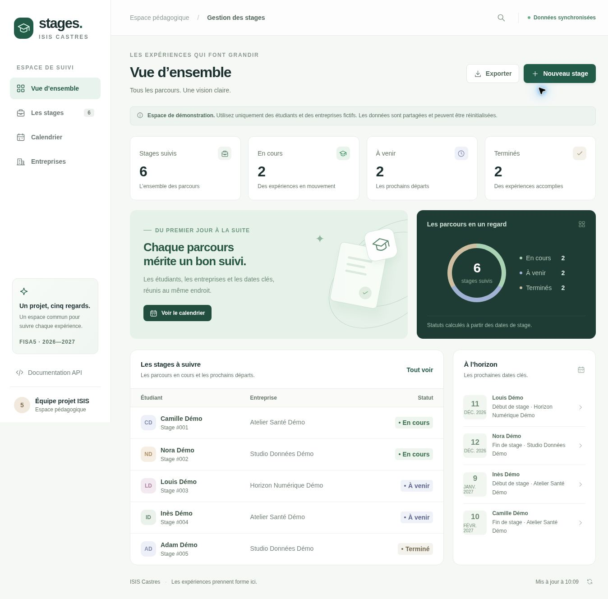
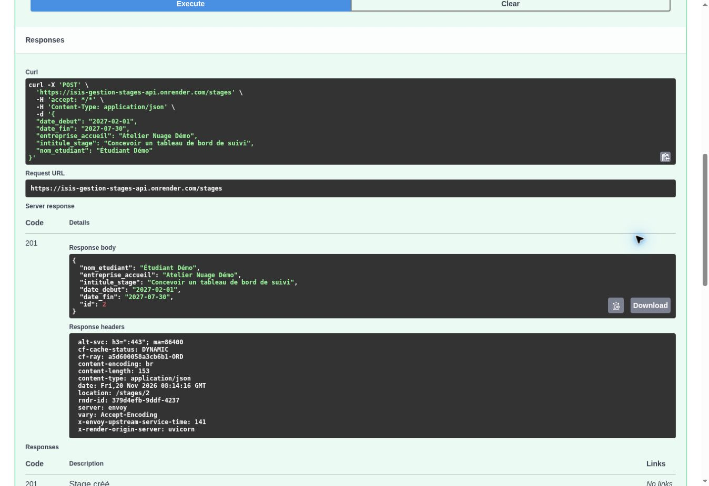
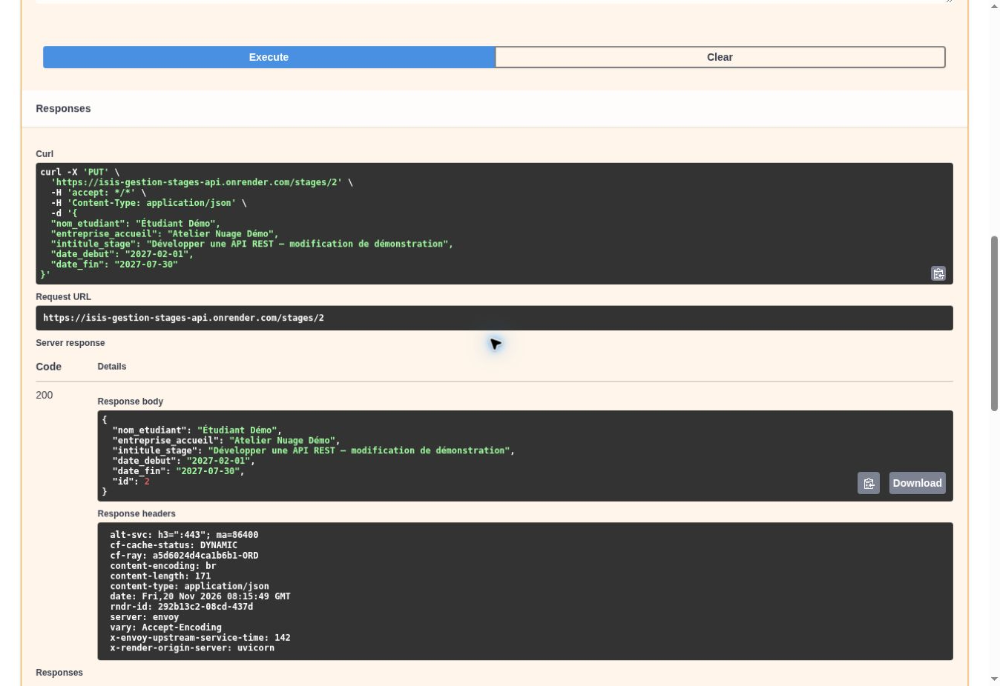
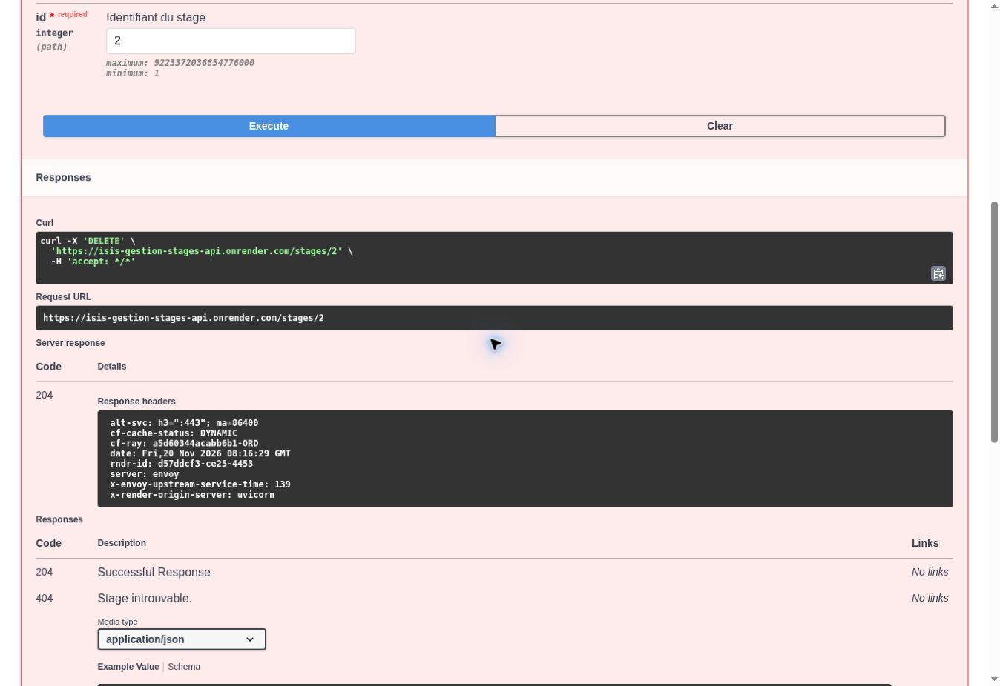

# Captures et preuves

## Visite guidée — 24 novembre 2026

La version **1.3.0**, code `b449de80dbc63c273cb93603e4cbec92645f859c`, est déployée sur Render et sa CI est réussie. La visite de six étapes se lance à la première ouverture dans un navigateur ; le bouton **?** la relance.

| Preuve de la version 1.3 | Contenu |
|---|---|
| [00-deploiement.json](../preuves/2026-11-24/00-deploiement.json) | Déploiement Live, source, service Free et exécution CI réussie. |
| [01-controle-public.txt](../preuves/2026-11-24/01-controle-public.txt) | Vérification HTTP des fichiers publics et CRUD avec nettoyage du stage temporaire. |
| [02-actions.txt](../preuves/2026-11-24/02-actions.txt) | Journal réel du job : 23 tests Python, 7 tests JavaScript, couverture Python, image Docker et contrôle HTTP. |
| [03-tutoriel-public.jpg](../preuves/2026-11-24/03-tutoriel-public.jpg) | Infobulle Ajouter un stage réellement ouverte sur le site public. |
| [04-tableau-de-bord-public.jpg](../preuves/2026-11-24/04-tableau-de-bord-public.jpg) | Six exemples fictifs, répartition 2 / 2 / 2 sur le service public. |
| [05-validation-visuelle.md](../preuves/2026-11-24/05-validation-visuelle.md) | Parcours, clavier, mémorisation, largeur réduite et contexte des contrôles. |

## Logo ISIS et guide - 23 novembre 2026

Source : `c31a9aeee3262532dfec4c9832663735747c2b33`. Le déploiement Render est **Live**, la CI est réussie et le contrôle public a validé l’API ainsi que les fichiers web. Les captures distinguent la prévisualisation de la version publique.

| Preuve de la version 1.2 | Contexte |
|---|---|
| [00-deploiement.json](../preuves/isis-2026-11-23/00-deploiement.json) | Reçu réel : commit, déploiement Live, service Docker Free, CI et résultats des vérifications. |
| [01-actions.txt](../preuves/isis-2026-11-23/01-actions.txt) | Extraits réels du job réussi : couverture Python, tests JavaScript, image et parcours HTTP Docker avec les nouveaux fichiers. |
| [02-interface-preview.jpg](../preuves/isis-2026-11-23/02-interface-preview.jpg) | Accueil avec le logo original, corail/violet et six exemples fictifs sur le serveur de prévisualisation. |
| [03-guide-preview.jpg](../preuves/isis-2026-11-23/03-guide-preview.jpg) | En-tête et début du guide de compréhension en prévisualisation. |
| [04-validation-visuelle.md](../preuves/isis-2026-11-23/04-validation-visuelle.md) | Parcours observés, largeur réduite, inspection des huit pages du PDF et vérification du téléchargement. |
| [05-controle-public.txt](../preuves/isis-2026-11-23/05-controle-public.txt) | CRUD HTTPS réel avec suppression du stage temporaire ; égalité exacte des huit fichiers publics modifiés. |
| [06-interface-public.jpg](../preuves/isis-2026-11-23/06-interface-public.jpg) | Tableau de bord public avec logo ISIS et six stages fictifs, répartition 2 / 2 / 2. |
| [07-guide-public.jpg](../preuves/isis-2026-11-23/07-guide-public.jpg) | Guide réellement ouvert sur l’URL publique Render. |

Les preuves du 20 novembre conservent leur contexte et leur ancienne apparence. Elles ne sont pas présentées comme des captures du nouveau thème.

## Interface web : version publique du 20 novembre 2026

[Ouvrir l’application](https://isis-gestion-stages-api.onrender.com/#dashboard) · [Exécution Actions réussie du code déployé](https://github.com/Remi26d/ISIS_-gestion-stages-api/actions/runs/44708215645)

Le commit `5c235fbada557890d916709f5d4a49bd274db514` est déployé sur le service Docker Free. Le [reçu](../preuves/interface/00-deploiement-interface.json) donne le service, le déploiement, le commit, les résultats et le contexte des contrôles. Les [extraits Actions](../preuves/interface/09-actions-interface.txt) confirment les 23 tests Python, les 100 % de couverture Python, les 7 tests JavaScript et le contrôle de l’image Docker, y compris l’accueil et ses ressources.

Le [contrôle HTTP public](../preuves/interface/01-controle-http-public.txt) a réussi sur le commit d’ajout de l’interface `84314af2ad1b1f42435c68d92f2cd5ab5470ce29`. Le commit suivant corrige uniquement le retour en haut de page lors du changement de vue ; il a été vérifié dans le navigateur public et dans la CI. Les six exemples fictifs ont ensuite été chargés dans la version finale pour la démonstration.

| Capture publique originale | Contenu |
|---|---|
| [02-tableau-de-bord.jpg](../preuves/interface/02-tableau-de-bord.jpg) | Six stages, répartition 2 / 2 / 2, aperçu et échéances. |
| [03-liste-des-stages.jpg](../preuves/interface/03-liste-des-stages.jpg) | Liste, recherche, filtres, tri et actions de modification et suppression. |
| [04-fiche-stage.jpg](../preuves/interface/04-fiche-stage.jpg) | Fiche de Camille Démo, dates et avancement calendaire. |
| [05-entreprises.jpg](../preuves/interface/05-entreprises.jpg) | Trois entreprises et leurs indicateurs calculés. |
| [06-calendrier.jpg](../preuves/interface/06-calendrier.jpg) | Départs et fins de stage dans le calendrier de décembre 2026. |
| [07-formulaire.jpg](../preuves/interface/07-formulaire.jpg) | Formulaire de création avec les cinq champs éditables. |

Le contrôle de largeur réduite porte sur 340 pixels CSS, obtenus par zoom du navigateur : la largeur du document observée est de 337 pixels et le menu compact fonctionne. Il ne s’agit pas d’un test sur téléphone physique. Ces preuves de l’interface complètent les captures Swagger ci-dessous.

## Preuves locales jointes

| Fichier | Contenu vérifiable |
|---|---|
| [01-tests-couverture.txt](../preuves/local/01-tests-couverture.txt) | Sortie réelle de la suite, des résultats et de la mesure des lignes. |
| [02-parcours-http.txt](../preuves/local/02-parcours-http.txt) | Requêtes du scénario complet sur Uvicorn local et statuts reçus. |
| [03-journaux-uvicorn.txt](../preuves/local/03-journaux-uvicorn.txt) | Journaux de démarrage, d’accès et d’arrêt du serveur HTTP local. |
| [04-pytest-cov.txt](../preuves/local/04-pytest-cov.txt) | 21 tests réussis et couverture des instructions et branches mesurée avec pytest-cov le 20 novembre 2026. |
| [05-ruff.txt](../preuves/local/05-ruff.txt) | Contrôle Ruff réussi le 20 novembre 2026. |

Ces traces correspondent à une exécution hors conteneur avec une base temporaire. Les preuves Docker et Render ci-dessous documentent les autres environnements.

## Journal Docker fourni par le groupe

Le [journal Docker du 20 novembre 2026](../preuves/docker/00-validation-docker.txt) confirme la construction de l’image, le démarrage du conteneur, l’accès au port publié et le CRUD complet. Les captures du terminal et de Swagger dans ce conteneur local restent à joindre depuis le PC.

## Exécution GitHub Actions vérifiée

Les exécutions [44699251269](https://github.com/Remi26d/ISIS_-gestion-stages-api/actions/runs/44699251269) et [44699902443](https://github.com/Remi26d/ISIS_-gestion-stages-api/actions/runs/44699902443) sont terminées avec la conclusion `success`. La seconde porte sur le commit applicatif déployé dans Render. Les [extraits du journal](../preuves/github/01-actions-validation.txt) montrent les tests, les 100 % de couverture et le CRUD en conteneur. Une capture de l’interface Actions peut compléter ces traces.

## Service Render et captures réalisées

[Ouvrir Swagger public](https://isis-gestion-stages-api.onrender.com/docs) · [Tableau de bord du service](https://dashboard.render.com/web/srv-dc000o142hec738a2lhg).

Le [reçu Render](../preuves/render/00-deploiement.json) conserve les paramètres du service Docker **Free**, la région Frankfurt, le commit applicatif et l’état `live`. Le [parcours HTTP public](../preuves/render/03-parcours-http.txt) réussit toutes les opérations. Les [journaux Render](../preuves/render/07-journaux-render.txt) confirment le démarrage d’Uvicorn et les appels HTTP.

Les sept images ci-dessous sont des captures originales du navigateur pendant les essais sur le service public le 20 novembre 2026. Les captures de réponse montrent l’URL HTTPS réellement appelée. Le stage fictif d’id `2` a été supprimé après sa modification. Elles documentent le service public, et ne remplacent pas les captures du PC sous Windows.

| Capture originale | Résultat visible |
|---|---|
| [01-swagger-public.jpg](../preuves/render/captures/01-swagger-public.jpg) | Routes et schémas chargés dans Swagger. |
| [02-swagger-post-201.jpg](../preuves/render/captures/02-swagger-post-201.jpg) | Création `201`, corps retourné, id `2` et en-tête `Location`. |
| [03-swagger-get-200.jpg](../preuves/render/captures/03-swagger-get-200.jpg) | Lecture `200` du stage d’id `2`. |
| [04-swagger-put-200.jpg](../preuves/render/captures/04-swagger-put-200.jpg) | Remplacement `200`, nouvel intitulé conservé, même id. |
| [05-swagger-delete-204.jpg](../preuves/render/captures/05-swagger-delete-204.jpg) | Suppression `204` sans corps de réponse. |
| [06-swagger-get-404.jpg](../preuves/render/captures/06-swagger-get-404.jpg) | Lecture après suppression : `404`, `Stage introuvable.` |
| [08-swagger-liste-200.jpg](../preuves/render/captures/08-swagger-liste-200.jpg) | Liste `200`, tableau vide `[]` après nettoyage. |

### Création sur Render

### Modification sur Render

### Suppression puis lecture du stage absent

## Captures complémentaires recommandées depuis le PC

L’énoncé demande quelques captures de fonctionnement et de déploiement, sans imposer ces trois vues locales précises. Les captures déjà jointes et les journaux constituent des preuves disponibles ; les éléments ci-dessous renforcent la lisibilité du dossier.

Le [guide Windows](guide-windows.md) donne les actions exactes dans GitHub Desktop, PowerShell, Swagger et Render. Les journaux Docker et Render sont déjà joints. Utiliser les données fictives fournies dans Swagger et conserver l’`id` renvoyé par `POST` pour enchaîner les opérations sur le même stage.

| Fichier à obtenir | Quand et quoi montrer | Exigence |
|---|---|---|
| `docker/01-conteneur.png` | Après `docker build` et `docker run`. Montrer le résultat du build et la ligne du conteneur actif avec son port. | E04 |
| `docker/02-swagger-creation-201.png` | Ouvrir `/docs` via le port publié. Déplier `POST /stages`, exécuter l’exemple puis afficher le corps et le statut `201`. | E03, E05 |
| `render/01-deploiement-live.png` | Ouvrir l’événement **Live** après déploiement. Garder le commit et le nom du service visibles. | E07, E09 |
| `render/captures/*.jpg` | **Déjà réalisées et jointes** : réponses du CRUD sur l’URL HTTPS Render. Le résultat complet de `scripts/verifier_service.py` est joint. | E03, E07, E09 |
| `03-actions-et-couverture.png` | Facultatif en complément des journaux et liens déjà vérifiés : ouvrir **Qualité et Docker** dans GitHub Actions, puis déplier les résultats de pytest-cov et du build. | Q01, Q02 |

Dans Swagger, ouvrir une route, sélectionner **Try it out**, saisir le corps ou l’`id` si nécessaire, puis sélectionner **Execute**. Dans Postman, importer l’URL de `/openapi.json` puis choisir le serveur correspondant au test local ou public. Pour `POST` et `PUT`, envoyer du JSON dans le corps de la requête.

Les journaux montrent les statuts du contrôle complet. Pour illustrer aussi le remplacement et la suppression dans Swagger, ajouter les captures `docker/03-lecture-et-put-200.png` et `docker/04-delete-204-et-get-404.png`.

Le lien du dépôt et l’URL Render sont renseignés dans le README. Avant la remise, confirmer que le dépôt privé est accessible à l’enseignante et indiquer le commit de remise. `ed8258ebeff0e89967831a40cf612dff315567c0` est le déploiement API historique ; la section de chaque version conserve son propre commit. Les ajouts limités aux preuves peuvent utiliser `[skip render]`. Dans le tableau de bord, choisir un cadrage qui exclut les paramètres de compte et les éventuelles valeurs confidentielles.
